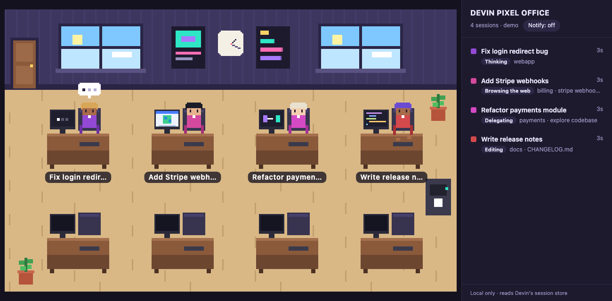

# devin-pixel-office

**Every Devin session becomes a little pixel character in a tiny office, live.** It types when Devin edits,
watches green text scroll when Devin runs commands, browses when Devin researches, **raises a hand with a red `!`**
when Devin needs your approval, sips coffee when it is done, and falls asleep on the desk when idle too long.



```bash
npx github:kaili-yang/devin-pixel-office          # opens http://127.0.0.1:4777
npx github:kaili-yang/devin-pixel-office --demo   # scripted office, no Devin data needed
```

No setup in Devin: it follows the local session store that **Devin CLI and Devin Desktop** share
(`~/.local/share/devin/cli/sessions.db`, read-only) and updates within a second. Everything stays on `127.0.0.1`.

## What the characters do

| Devin is… | Character | Status |
|---|---|---|
| generating a reply | thought bubble `...` (red `x` + smoke after a failed command) | Thinking |
| `edit` / `write` / `apply_patch` | typing, code appears on screen | Editing |
| `exec` and other shell tools | typing, green terminal scrolls | Running a command |
| `read` / `grep` / `glob` | reading a book, highlighted line moves | Reading code |
| `web_search` / `webfetch` / browser MCPs | browser on screen | Browsing the web |
| `run_subagent` | handing work to a second figure | Delegating |
| `todo_write` | checklist fills up | Planning |
| `ask_user_question` | hand up, yellow `?`, desk glows | Has a question |
| asking for tool permission (with hooks) | hand up, red `!`, desk pulses | Needs your approval |
| finished a turn | smiles, coffee, green ✓ | Done |
| idle 10+ minutes | asleep on the desk, `Z z z` | Idle |
| idle 60+ minutes | walks out the door | — |

New sessions walk in through the door and take a free desk (8 desks; extra sessions are listed in the side panel).
The windows follow your local time (day, sunset, night with stars) and the clock is real.

The side panel lists every session with its project, current command / file / URL and how long it has been in
that state, sorted so the ones waiting for you are on top. The tab title shows `(n)` when sessions wait for you,
and **Notify** turns on desktop notifications for approvals, questions and finished turns.

## Approvals (optional hooks)

The store alone can't tell a long-running command from one waiting for your approval. To get the red `!` the moment
Devin asks for permission, add the hooks (they `curl` the office on `127.0.0.1` and fail open):

```bash
npx github:kaili-yang/devin-pixel-office install-hooks      # writes ~/.config/devin/config.json (backup kept)
npx github:kaili-yang/devin-pixel-office uninstall-hooks
```

Restart Devin after installing. Use the same `--port` for `install-hooks` and the server if you change it.

## Options

| | |
|---|---|
| `--port <n>` | default `4777` (127.0.0.1 only) |
| `--window <min>` | show sessions active in the last *n* minutes (default 120) |
| `--db <path>` | another session store (or `DEVIN_SESSIONS_DB`) |
| `--demo` | scripted sessions |
| `--no-open` | don't open the browser |

## How it works

```
sessions.db ──poll 0.7 s──▶ StorePoller ──▶ inferStatus() ──▶ SSE /events ──▶ canvas (320×200, drawn in code)
Devin hooks ──curl /hook──▶ Office (PermissionRequest → waiting)  ─┘
```

All art is drawn procedurally in [`public/app.js`](public/app.js), no image assets. The server only answers requests
whose `Host` is `127.0.0.1` / `localhost`.

## Development

Node ≥ 22.13 (built-in `node:sqlite`), zero dependencies.

```bash
npm test
npm run demo
```

MIT © Kelly Yang
